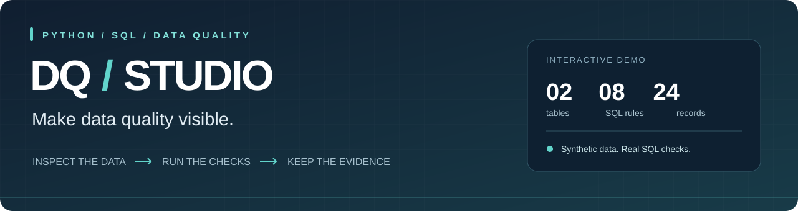
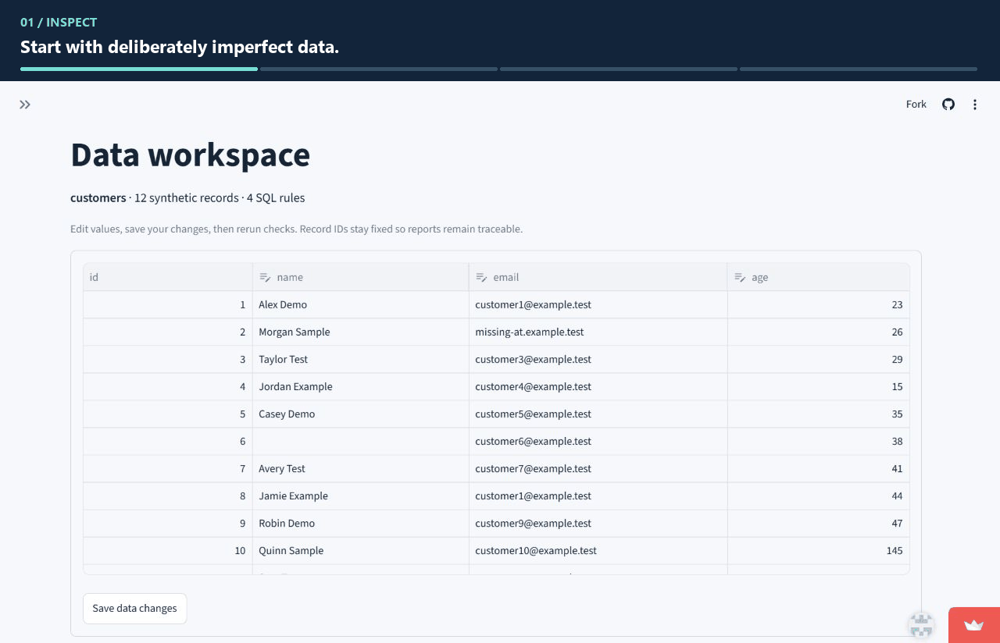
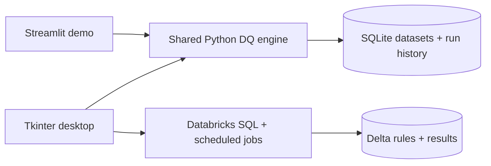

<p align="center">
  
</p>

<p align="center">
  <a href="https://alan-dq-studio.streamlit.app/"></a>
  <a href="docs/WEB_DEMO.md"></a>
</p>

<p align="center">
  <a href="https://github.com/alan-przybylski/python_DQ_Application/actions/workflows/tests.yml"></a>
  
</p>

<p align="center"><strong>Find the bad records. Understand the rule. Verify the repair.</strong><br>
A Python and SQL data quality project by <a href="https://github.com/alan-przybylski">Alan Przybylski</a>.</p>

DQ Studio turns SQL checks into traceable reports: which rule ran, which records
failed and what changed after a repair. Explore the browser demo in a few clicks,
or use the desktop application with local datasets and Databricks.

## Try it in two minutes

**[Open the live demo →](https://alan-dq-studio.streamlit.app/)** No installation or sign-in.

1. **Explore** — choose `customers` or `products` and inspect the deliberately imperfect data.
2. **Investigate** — open **Rule library**, read the SQL and inspect failures in **Quality report**.
3. **Repair** — in **Data workspace**, edit a value or choose **Apply clean sample + run checks**.
4. **Verify** — compare the new report with the original run. The earlier evidence stays available.

<p align="center">
  <a href="https://alan-dq-studio.streamlit.app/"></a>
</p>

<p align="center"><sub>Actual browser captures · synthetic data · <a href="docs/images/web/report-clean.png">View the final report as a still image</a></sub></p>

| Demo dataset | Records | Four checks |
|---|---:|---|
| `customers` | 12 | Required name · email format · age range · unique email |
| `products` | 12 | Unique SKU · required name · positive price · valid launch date |

Every visitor gets a separate temporary database. **Reset demo** restores the
starting data and baseline reports. Changes last for the browser session.
The public demo runs on SQLite; the desktop application provides live Databricks access.

## One project, two ways to explore

| | Browser demo | Desktop application |
|---|---|---|
| Data | Two editable synthetic datasets | CSV datasets, local tables and Databricks |
| Rules | Eight saved rules + SQL draft previews | Rule creation, versions, local/cloud filtering and publication |
| Execution | One rule or all four for a dataset | Local checks and Databricks runs |
| Evidence | Per-run counts, failed records and CSV export | Reports, trends, run history and DQ tickets |
| Workspace | Session-scoped, resettable | Persistent SQLite storage, profiles and PL/EN interface |

The desktop has separate **Local** and **Databricks** workspaces, a shared
**Rule library**, and reports that can be filtered by execution environment.
Cloud rules use ordinary SQL and fully qualified table names. Results can be
downloaded into the application without importing the source tables.

**[Desktop guide](docs/DESKTOP_GUIDE.md)** · **[Databricks setup](docs/DATABRICKS.md)** · **[Scheduled jobs & result sync](docs/DATABRICKS_SYNC.md)**

## SQL you can inspect

```sql
SELECT id,
       age,
       CASE
           WHEN age BETWEEN 18 AND 120 THEN 0
           ELSE 1
       END AS dq_check
FROM customers;
```

**`0` = PASS · `1` = FAIL.** Each row identifies a record and its tested field.
Counts and failed values belong to a specific run; changing the data does not
rewrite that run's report. SQL execution errors are reported separately from
data quality failures.

## How it is built



- **Shared execution logic:** the web and local desktop checks use `logic/dq_engine.py`.
- **Traceable evidence:** run IDs link rule versions, aggregate counts and row-level findings.
- **Atomic persistence:** a rule's counts and details commit together using SQLite savepoints.
- **Controlled SQL previews:** read-only dataset access, output validation, row and time limits.
- **Session isolation:** the browser demo supplies its own database path without changing global desktop configuration.
- **Regression coverage:** core tests on Windows/Linux, desktop GUI checks on Windows and web checks on Python 3.13.

**[Architecture & tradeoffs](docs/ARCHITECTURE.md)** · **[Security notes](SECURITY.md)** · **[Changelog](CHANGELOG.md)**

## Run it locally

Clone the project, then choose an interface. These commands use [uv](https://docs.astral.sh/uv/).

```bash
git clone https://github.com/alan-przybylski/python_DQ_Application.git
cd python_DQ_Application
```

**Web demo · Python 3.13**

```bash
uv run --no-project --python 3.13 --with-requirements web_demo/requirements.txt python -m streamlit run web_demo/app.py
```

Open `http://localhost:8501`. [Deployment and session details](docs/WEB_DEMO.md).

**Desktop demo · Windows, Python 3.14 and Tkinter**

```bash
uv sync --frozen
uv run --frozen python main.py --demo
```

A fresh desktop demo uses **`demo` / `Demo2026`** and contains its own customer
dataset, three rules and seeded history. Its database is reused between launches.
Run `uv run --frozen python main.py` to create your own local workspace.
[Setup, launchers and account management](docs/DESKTOP_GUIDE.md).

<details>
<summary><strong>Repository map and test commands</strong></summary>

```text
web_demo/       Streamlit UI, synthetic data and per-session storage
ui/             Tkinter screens and navigation
logic/          DQ engine, datasets, rule versions, reports and tickets
integrations/   Databricks execution and SQL support
database/       SQLite schema and migrations
rules/          Example version-controlled SQL rules
tests/          Behavior, data integrity and UI tests
docs/           Guides, architecture and real application captures
```

```powershell
# Core and desktop regression suite
uv run --frozen pytest -q

# Web behavior and interface checks, with the demo dependencies
uv run --no-project --python 3.13 --with-requirements web_demo/requirements.txt --with pytest python -m pytest tests/test_web_demo.py -q

# Desktop GUI tests on Windows
$env:DQ_GUI_TESTS = '1'
uv run --frozen pytest -q
```

Tests use temporary databases. Private databases, profiles and generated exports
are Git-ignored. `main` is the published version; ongoing work happens on `dev`.

</details>

---

<p align="center"><strong>Built by Alan Przybylski</strong><br>
Python · SQL · Data Quality · Databricks<br>
<a href="https://alan-dq-studio.streamlit.app/">Explore the demo</a> · <a href="https://github.com/alan-przybylski">GitHub profile</a></p>
